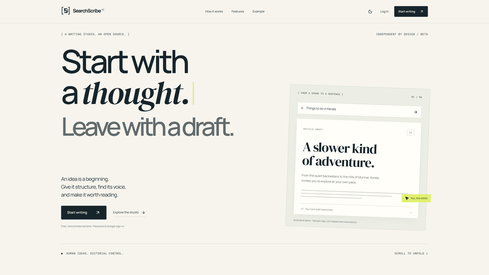
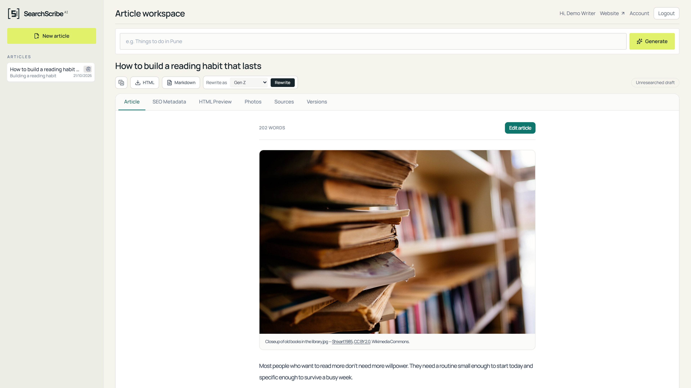
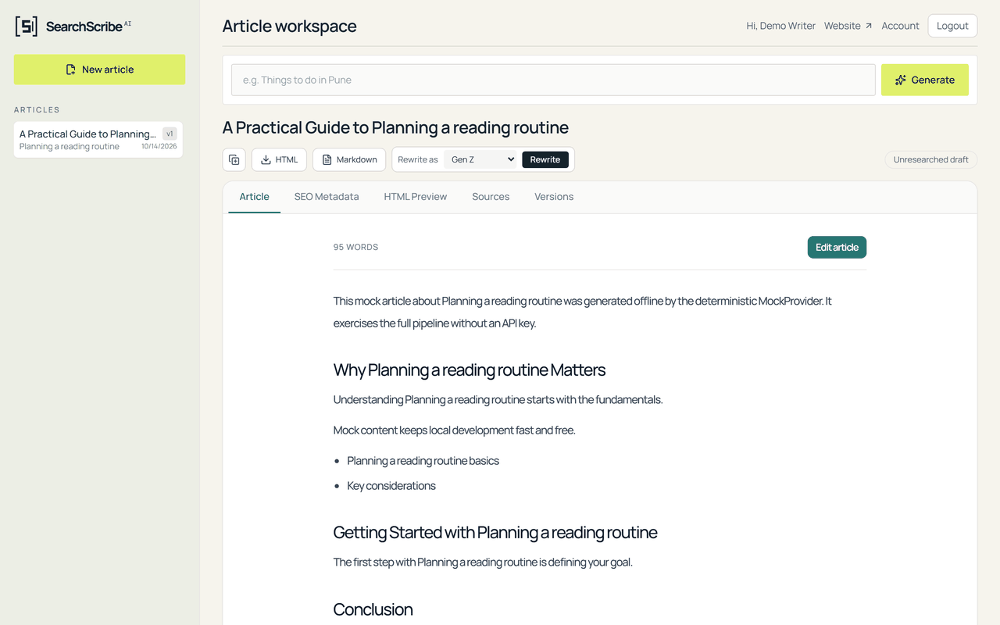

# SearchScribe AI

<picture>
  <source media="(prefers-color-scheme: dark)" srcset="frontend/public/brand/logo-wordmark-light.svg">
  
</picture>

**Start with a thought. Leave with a draft.**

An open-source writing studio with web research, editable articles and SEO,
version history, and HTML or Markdown export.

[Try the website](https://searchscribe-ai.vercel.app/) · [How it works](https://searchscribe-ai.vercel.app/how-it-works) · [Contribute](CONTRIBUTING.md) · [MIT license](LICENSE)

[](https://github.com/abhay-yemekar/SearchScribe_AI_Studio/actions/workflows/ci.yml)

SearchScribe is built for bloggers and creators who want an editable starting point
and control over the result. AI supplies a draft; the writer reviews the facts,
changes the language, and decides what to publish.

## The writing journey

1. **Start with a topic.** Generate a title, introduction, sections, conclusion,
   and SEO metadata together through the configured Gemini provider. Review
   status identifies AI drafts, metadata needing review, and your saved SEO edits.
2. **Shape the article.** Edit the structured content and SEO fields. Save a new
   version; stale edits are rejected rather than silently overwriting newer work.
   Unsaved changes are marked, with keep/discard prompts before leaving the draft.
3. **Try another voice.** Rewrite in Professional, Casual, Gen Z, Technical,
   Marketing, or Minimal style.
4. **Keep your history.** Inspect and restore saved versions. Restoration creates
   another version instead of erasing the intervening work.
5. **Take the result with you.** Download standalone, sanitized HTML or editable
   Markdown from the saved version, with its research status and source links.

The public website explains the product before login. `/dashboard` is the writing
workspace; `/account` manages sign-in connections. Password signup and login remain
available alongside the configured Google sign-in integration.

## A look inside



An editorial website that introduces the product before sign-in. Original artwork,
responsive layouts, keyboard controls, and motion that respects reduced-motion settings.



The article stays first. SEO, HTML preview, sources, and versions have their own
tabs. Screenshots use a synthetic **Demo Writer** account and an offline mock
article, with no real account information.



Recorded from the working local interface, using deterministic mock content.
This is a product walkthrough, not a recording of live AI writing. Static
alternatives: [homepage](screenshots/studio-home-4k.png),
[workspace](screenshots/studio-workspace-4k.png), and
[editorial artwork](screenshots/studio-editorial-4k.png).

## Beta status

This is a **free, noncommercial beta**. AI drafts need editorial review before
publication; a retrieved source or valid JSON response does not certify accuracy.

| Available            | Scope                                                                         |
| -------------------- | ----------------------------------------------------------------------------- |
| Topic-based research | Tavily search, bounded excerpts, visible links and estimated source dates     |
| Article + SEO        | Structured drafts, complete metadata targets, editable review status          |
| Editorial control    | Six rewrite styles, saved versions, conflict and unsaved-edit protection      |
| Portable output      | Sanitized HTML and Markdown with source provenance                            |
| Sign-in              | Password and configured Google sign-in, explicit linking, password management |
| Resilience           | Bounded requests, useful quota errors, and configured research-role fallback  |

Automatic article-provider fallback and draft evidence correction remain disabled
in the deployed beta until their quality gates pass. Recovery email is deployed;
direct token-bearing links remain disabled pending the email tracking acceptance
gate. Photo suggestions, persistent daily user quotas, backup-restore rehearsals,
and deployment rollback rehearsals remain planned or incomplete. See the
[launch plan](docs/launch-plan.md) for the detailed acceptance checklist.

## Run it locally

Prerequisites: **Python 3.12+**, **Node.js 20.9+**, and npm. SQLite and the mock AI
provider let you develop without Docker, a cloud account, or a paid API key.

The commands below use Windows PowerShell. On macOS/Linux, use `.venv/bin/python`
instead of `.venv\Scripts\python.exe`, and `cp` instead of `Copy-Item`.

```powershell
git clone https://github.com/abhay-yemekar/SearchScribe_AI_Studio.git
cd SearchScribe_AI_Studio
python -m venv .venv
.\.venv\Scripts\python.exe -m pip install -r backend/requirements.txt -r backend/requirements-dev.txt
Copy-Item backend/.env.example backend/.env
```

In `backend/.env`, set `AI_PROVIDER=mock` for deterministic local drafts. Keep
`APP_ENV=local` and the SQLite default. Set your own random `SECRET_KEY`; generate
one with `python -c "import secrets; print(secrets.token_urlsafe(48))"`. Do not
commit environment files. The mock provider produces sample content, not research
or live AI output.

Start the API:

```powershell
cd backend
../.venv/Scripts/python.exe -m alembic upgrade head
../.venv/Scripts/python.exe -m uvicorn app.main:app --reload
```

In another terminal, from the repository root:

```powershell
cd frontend
npm ci
npm run dev
```

Open [localhost:3000](http://localhost:3000). API documentation is at
[127.0.0.1:8000/docs](http://127.0.0.1:8000/docs). Next.js forwards `/api/*` to
the API; `BACKEND_URL` changes its destination. If you change ports, update that
setting and any configured Google authorized JavaScript origin together.

For manual development, copy `frontend/.env.example` to `frontend/.env.local`.
`backend/.env` holds the local provider settings; hosting secrets do not sync
to your laptop. Keep the existing Gemini key, choose an exact `AI_MODEL`, and
add your own `TAVILY_API_KEY` for web research. Groq roles need a local
`GROQ_API_KEY`; email and Google remain optional. Never copy a sample over an
existing secrets file. Restart the affected local process after env changes.

On Windows, after installing the dependencies above and running `npm ci` in
`frontend`, the project helper can start a safe mock preview and open it:

```powershell
pwsh -NoProfile -File frontend/scripts/runapp.ps1
```

The helper uses [localhost:3200](http://localhost:3200), a local API, and a preview
database. It requires PowerShell 7.4+ and never deploys production.

For real generation, select `AI_PROVIDER=gemini` and put your own `GEMINI_API_KEY`
in the backend environment. `AI_MODEL` selects an available model. Provider
accounts, limits, and data-use terms apply; the MIT license does not include API
credits. Google login is optional for self-hosting and needs a web client ID and
matching site origin. See the [authentication setup guide](docs/auth-setup.md).

## Stack and deployment

| Layer              | Implementation                                                                 |
| ------------------ | ------------------------------------------------------------------------------ |
| Website and studio | Next.js 16 App Router, React 19, TypeScript, Tailwind CSS, TanStack Query      |
| API                | FastAPI, Pydantic, SQLAlchemy 2, Alembic                                       |
| Generation         | Gemini and optional Groq adapters; offline mock provider for local development |
| Research           | Tavily search with bounded source excerpts, planning and evidence selection    |
| Storage            | SQLite locally; persistent Postgres in production                              |
| Validation         | Ruff, mypy, pytest, ESLint, TypeScript, Vitest, Playwright, Docker builds      |

The current personal beta uses **Vercel → Render → Neon Postgres**. Vercel's
server-side proxy keeps browser API requests on the website origin. Render runs
migrations before starting the API. Production settings require Postgres and a
strong signing secret and refuse the mock provider.

Self-hosting requires your own frontend, API, persistent Postgres, and provider
configuration. Free service plans have limits and cold starts; they do not promise
unlimited or always-on capacity. Vercel Hobby is for personal, noncommercial use.
See [deployment](docs/deployment.md) for configuration, optional Docker Compose,
backups, and rollback procedures. No production credentials belong in this repo.

## Check a change

From `backend`:

```powershell
../.venv/Scripts/python.exe -m ruff check .
../.venv/Scripts/python.exe -m mypy app
../.venv/Scripts/python.exe -m pytest
```

From `frontend`:

```powershell
npm run lint
npm run typecheck
npm test
npm run build
npx playwright install chromium
npx playwright test
```

Playwright starts an isolated mock API on `:8001` and a frontend on `:3100`.
GitHub Actions additionally runs backend tests against SQLite and Postgres.
See [testing](docs/testing.md) for environment details.

## Build in the open

Start with an issue describing the user problem. Use a feature branch and
Conventional Commits; open a PR, pass the current CI checks, review the diff, and
squash merge. See [CONTRIBUTING.md](CONTRIBUTING.md). Keep planned features separate
from shipped behavior and preserve existing user content.

Useful references: [architecture](docs/architecture.md), [AI pipeline](docs/ai-architecture.md),
[API](docs/api.md), [database](docs/database.md), [security](docs/security.md),
[design system](docs/design-system.md), and [brand assets](docs/brand.md).

Maintained by [Abhay Yemekar](https://github.com/abhay-yemekar). Licensed under
[MIT](LICENSE).
